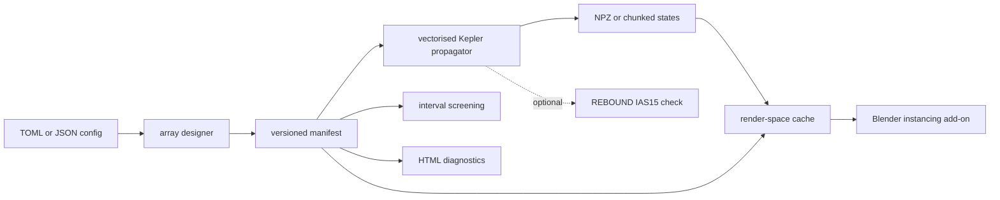

# OrbitWeaver

OrbitWeaver designs and screens large collections of **independently orbiting** satellites, collectors, and modules around one dominant central body. Version 0.1 propagates bound Keplerian ellipses. It is a layout and trajectory screen for shells, collector families, and orbital arrays.

A symmetric picture is not a stability proof. Equal orbital elements are not a rigid ring. Sampled positions are not a certificate for all future time.



The core package never imports Blender. The add-on lives in `blender_addon/orbitweaver_preview/`.

## Scope

| In v0.1 | Not in v0.1 |
| --- | --- |
| Newtonian point-mass ellipses, test particles, fixed central body | Mutual gravity, N-body stability |
| SI internally, Astropy units at the boundary | Hyperbolas, relativity, frame dragging |
| Seeded shells, ring families, inclination families | Rigid rings, station-keeping |
| Sampled screening with an explicit miss bound | A claim of collision-free motion for all time |
| Float64 science coordinates, float32 render coordinates | One Blender object per satellite by default |

The physical model, the singular-angle conventions, and the sampling bound are in [docs/physics.md](docs/physics.md). Frames and time scales are in [docs/frames-and-units.md](docs/frames-and-units.md). Claims this version refuses to make are in [docs/limitations.md](docs/limitations.md).

## Install

Python 3.11 or newer.

```bash
pip install -e ".[dev]"
```

Runtime dependencies are NumPy, SciPy, and Astropy, all BSD-licensed. REBOUND is optional (`pip install -e ".[rebound]"`) and is GPL-3.0-only. The Kepler core runs without it. WHFast is not used: it is for weakly perturbed systems, not for close encounters. The optional check uses IAS15 and reports **unverified** when REBOUND is absent.

## Commands

```bash
orbitweaver generate examples/solar_collector_shell.toml --out build/shell
orbitweaver propagate build/shell/manifest.json --duration 365d --step 1d --out build/ephemeris
orbitweaver screen build/shell/manifest.json --duration 365d --step 1h --out reports/encounters
orbitweaver report build/shell/manifest.json --out reports/design.html
orbitweaver doctor
```

Durations need a unit: `s`, `min`, `h`, `d`, or `yr` (Julian year). `365` is rejected. Epochs need a time scale (`tt`, `tdb`, `utc`, …).

Other scenes:

| File | What it is |
| --- | --- |
| `examples/reference_circular.toml` | One circular Earth orbit. Epoch state and period match the analytic circle. |
| `examples/elliptical_shell.toml` | Twelve inclined ellipses, seed 42. |
| `examples/close_approach.toml` | Two circles that meet on the node line. Screening is expected to catch the crossing when refinement is on. |
| `examples/ring_family.toml` | Phased family on one circular orbit. Not a rigid ring. |
| `examples/invalid_elements.toml` | Hyperbolic eccentricity. Generation fails and names `BAD-HYPERBOLA`. |
| `examples/deliberately_invalid.toml` | Pericentre inside Earth, kept only as a negative test. |
| `examples/visual_only_point_mass.toml` | Artwork. Same Newtonian ellipse. Not a black hole. |
| `examples/solar_collector_shell.toml` | 1000 independent collectors, Sun preset, seed 161803398, isotropic inclinations. |

Propagation writes only the requested times. Above two million state vectors the archive is chunked on the orbit axis. A preview cache is separate from the science file:

```bash
orbitweaver propagate build/shell/manifest.json --duration 30d --step 1d \
  --out build/preview --preview-metres-per-unit 1e9 --floating-origin-id COL-000000
```

`1e9` means one render unit is \(10^9\) metres. It does not change the semi-major axes. Float32 precision at astronomical range still requires the origin to sit near the subject; `doctor` and the preview sidecar report the step size.

## Blender

Zip `blender_addon/orbitweaver_preview` and install it as a legacy add-on (Blender 4.x). The sidebar panel loads a manifest, builds one collector icosphere, and instances it on a point cloud through Geometry Nodes. Animation evaluates the scalar preview solver, which is checked against the NumPy propagator in `tests/test_visualisation.py`.

`orbitweaver doctor` prints `preview_status: unverified` when the `blender` executable is absent. Do not treat that as a completed visual test. No screenshot is shipped, because none was rendered.

## Layout of the code

```
src/orbitweaver/
  models.py            bodies, orbits, singularity warnings
  units.py             strict durations, lengths, epochs
  orbital_elements.py  inverse map, energy, angular momentum
  kepler.py            safeguarded solver and vectorised states
  array_design.py      seeded shells and separation
  screening.py         samples, refinement, miss bound
  export.py            manifest, NPZ, chunks
  visualisation.py     render space, no Blender import
  cli.py               orbitweaver command
blender_addon/orbitweaver_preview/
examples/  tests/  docs/
```

## Tests

```bash
ruff check src tests blender_addon
pytest
```

The suite checks circular closure, folded Kepler residuals through eccentricities very near 1, energy and angular-momentum conservation, element singularities, seed reproducibility, a known crossing, a separated pair, the sampling certificate, manifest round-trip, and the preview solver.

Observed propagation timings, measured on a specific machine and not offered as a promise, are in `docs/benchmarks/observed.json` (`orbitweaver benchmark --out docs/benchmarks/observed.json`). An optional IAS15 comparison, run only when REBOUND imports, is in `docs/benchmarks/rebound_ias15.json`. A missing install is unverified, not a pass.

## Licence

BSD-3-Clause. See [LICENSE](LICENSE). The optional REBOUND extra is GPL-3.0-only and is not vendored.
